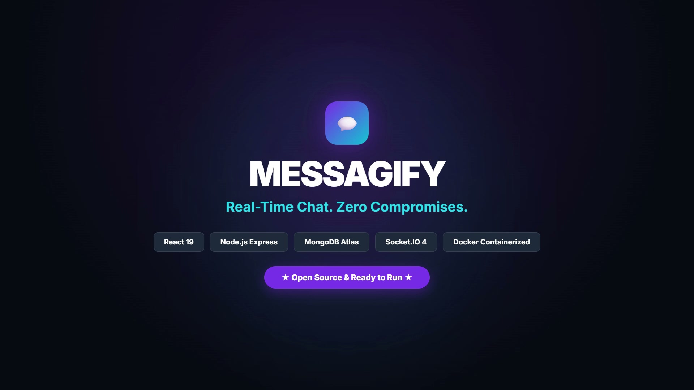

# Messagify

A production-grade, real-time messaging platform built on the MERN stack with Socket.IO, featuring persistent two-way communication, in-browser audio voice notes, group channels, message reactions, and dynamic UI theming.

---

## Table of Contents

- [Overview](#overview)
- [System Architecture](#system-architecture)
- [Key Features](#key-features)
- [Technology Stack](#technology-stack)
- [Project Structure](#project-structure)
- [Prerequisites](#prerequisites)
- [Environment Configuration](#environment-configuration)
- [Local Development Installation](#local-development-installation)
- [Docker Deployment](#docker-deployment)
- [REST API Reference](#rest-api-reference)
- [WebSocket Event Specification](#websocket-event-specification)
- [Automated Testing](#automated-testing)
- [Production Deployment Guide](#production-deployment-guide)
  - [Backend Deployment (Render)](#backend-deployment-render)
  - [Frontend Deployment (Vercel / Netlify)](#frontend-deployment-vercel--netlify)
- [Media & Launch Assets](#media--launch-assets)
- [Security Model](#security-model)
- [License](#license)

---

## Overview

Messagify is an enterprise-ready messaging service designed to deliver sub-millisecond event transmission between authenticated clients. Built with Node.js, Express, MongoDB Atlas, and Socket.IO on the backend, paired with a React 19 single-page application using Zustand state management and Tailwind CSS / DaisyUI, it delivers full-featured communication capabilities with strict data isolation and security standards.

---

## System Architecture

```
+-------------------------------------------------------------------+
|                        Client Layer (React 19)                    |
|  Zustand Stores  |  Web Audio API  |  Axios Client  |  Socket.IO  |
+---------------------------------+---------------------------------+
                                  |
               HTTPS (REST API)   |   WSS (Persistent WebSockets)
                                  v
+-------------------------------------------------------------------+
|                        Application Layer                          |
|  Express 5 API Gateway  |  Socket.IO Server  |  JWT Middleware   |
|  Rate Limiting (Auth/Msg)  |  Helmet Security  |  CORS Whitelist |
+---------------------------------+---------------------------------+
                                  |
                     Mongoose ODM | Cloudinary SDK
                                  v
+-------------------------------------------------------------------+
|                         Data & Media Tier                         |
|      MongoDB Atlas (Replica Set)      |      Cloudinary CDN       |
|   (Compound Indexes, Schema Rules)    |   (Media Storage / Opt)   |
+-------------------------------------------------------------------+
```

---

## Key Features

### Real-Time Communication
- Full-duplex communication using persistent WebSocket connections with fallback transports.
- Multi-device and multi-tab session management using per-user socket pool sets.
- Real-time partner presence detection (online and offline status broadcasting).
- Typing indicators with debounced activity state.

### Rich Media & Voice Notes
- Integrated voice recording utilizing the HTML5 `MediaRecorder` API.
- Custom inline audio waveform visualizer and scrubber with playback controls.
- Image uploads powered by Cloudinary with client-side preview and modal lightbox viewer.

### Message Lifecycle Management
- In-place message editing with visual `(edited)` markers.
- Soft-delete functionality with custom in-site confirmation dialogs (no browser alerts).
- Emoji reactions with live counter aggregation and user reaction tracking.
- Read receipts featuring delivery status indicators (single check for sent, double check for read).

### Multi-User Channels
- Group conversation support with dynamic member management.
- Socket room partitioning (`group:<id>`) ensuring isolated event routing.
- Group-level typing indicators and participant metadata.

### Design System & Theming
- 32 switchable DaisyUI themes dynamically synced to the document root.
- Strict WCAG AA contrast compliance across interactive elements.
- Fully responsive layout optimized for mobile, tablet, and desktop viewports.

---

## Technology Stack

| Domain | Technology | Version / Specification |
|---|---|---|
| **Frontend Framework** | React | 19.x |
| **Build Tool** | Vite | 6.x |
| **State Management** | Zustand | 5.x |
| **Styling** | Tailwind CSS + DaisyUI | 3.4.17 + 4.12.23 (32 Themes) |
| **Icons & Media** | Lucide React | Modern SVG icons |
| **Backend Runtime** | Node.js | >= 18.x (ES Modules) |
| **Web Framework** | Express | 5.x |
| **Real-Time Engine** | Socket.IO | 4.x |
| **Database** | MongoDB Atlas | 8.x (Mongoose ODM) |
| **Authentication** | JSON Web Tokens (JWT) | HTTP-Only, Secure, SameSite Cookies |
| **Security** | Helmet, Express Rate Limit | Strict CSP & Anti-Brute-Force Policies |
| **Containerization** | Docker & Docker Compose | Multi-stage production builds |
| **Testing** | Vitest + Supertest | Unit & Integration test coverage |

---

## Project Structure

```
CHAT_APP/
|-- backend/
|   |-- src/
|   |   |-- controllers/      # Route handler implementations
|   |   |   |-- auth.controller.js
|   |   |   |-- group.controller.js
|   |   |   `-- message.controller.js
|   |   |-- lib/              # Database, Cloudinary, and Socket server initialization
|   |   |   |-- cloudinary.js
|   |   |   |-- db.js
|   |   |   |-- socket.js
|   |   |   `-- utils.js
|   |   |-- middleware/       # Authentication and request verification
|   |   |   `-- auth.middleware.js
|   |   |-- models/           # Mongoose entity schemas and indexes
|   |   |   |-- group.model.js
|   |   |   |-- message.model.js
|   |   |   `-- user.model.js
|   |   |-- routes/           # REST endpoint definitions
|   |   |   |-- auth.route.js
|   |   |   |-- group.route.js
|   |   |   `-- message.route.js
|   |   `-- index.js          # Application entrypoint
|   |-- tests/                # Automated integration test suite
|   |   `-- api.test.js
|   |-- Dockerfile
|   `-- package.json
|-- frontend/
|   |-- src/
|   |   |-- components/       # Reusable UI components
|   |   |   |-- ChatContainer.jsx
|   |   |   |-- ChatHeader.jsx
|   |   |   |-- MessageInput.jsx
|   |   |   |-- Navbar.jsx
|   |   |   |-- NoChatSelected.jsx
|   |   |   `-- Sidebar.jsx
|   |   |-- pages/            # Application views
|   |   |   |-- HomePage.jsx
|   |   |   |-- LoginPage.jsx
|   |   |   |-- ProfilePage.jsx
|   |   |   |-- SettingsPage.jsx
|   |   |   `-- SignupPage.jsx
|   |   |-- store/            # Global Zustand state stores
|   |   |   |-- useAuthStore.js
|   |   |   |-- useChatStore.js
|   |   |   `-- useThemeStore.js
|   |   |-- App.jsx
|   |   |-- index.css
|   |   `-- main.jsx
|   |-- Dockerfile
|   |-- nginx.conf
|   `-- package.json
|-- brag-output/              # Generated product assets and media
|   |-- brag.mp4              # 20-second launch film
|   `-- brag.jpg              # High-resolution poster frame
|-- docker-compose.yml
|-- .gitignore
`-- README.md
```

---

## Prerequisites

- **Node.js:** v18.0.0 or higher
- **npm:** v9.0.0 or higher
- **MongoDB:** Active MongoDB instance or MongoDB Atlas cluster connection string
- **Cloudinary:** Account credentials for media storage (API Key, Secret, Cloud Name)

---

## Environment Configuration

Create a `.env` file inside the `backend/` directory:

```env
PORT=5001
MONGODB_URI=mongodb+srv://<username>:<password>@cluster.mongodb.net/messagify?retryWrites=true&w=majority
JWT_SECRET=your_secure_random_jwt_secret_key_here
NODE_ENV=development

CLOUDINARY_CLOUD_NAME=your_cloudinary_cloud_name
CLOUDINARY_API_KEY=your_cloudinary_api_key
CLOUDINARY_API_SECRET=your_cloudinary_api_secret

# Optional: Set frontend origin if different from default localhost
CLIENT_URL=http://localhost:5173
```

---

## Local Development Installation

### 1. Clone the repository

```bash
git clone https://github.com/KURO-1125/Messagify.git
cd Messagify
```

### 2. Install dependencies

```bash
# Install backend dependencies
cd backend
npm install

# Install frontend dependencies
cd ../frontend
npm install
cd ..
```

### 3. Start services in development mode

```bash
# Terminal 1: Backend service (starts on http://localhost:5001)
npm run dev --prefix backend

# Terminal 2: Frontend client (starts on http://localhost:5173)
npm run dev --prefix frontend
```

---

## Docker Deployment

The application includes production-ready container configurations for both services.

```bash
# Build and run containers in detached mode
docker-compose up --build -d

# View service logs
docker-compose logs -f

# Terminate containers
docker-compose down
```

---

## REST API Reference

### Authentication Endpoints (`/api/auth`)

| Method | Endpoint | Description | Auth Required |
|---|---|---|---|
| `POST` | `/api/auth/signup` | Register a new user account | No |
| `POST` | `/api/auth/login` | Authenticate user and issue JWT cookie | No |
| `POST` | `/api/auth/logout` | Clear session cookie | Yes |
| `GET` | `/api/auth/check` | Validate session and return user profile | Yes |
| `PUT` | `/api/auth/update-profile` | Update user profile image | Yes |

### Messaging Endpoints (`/api/messages`)

| Method | Endpoint | Description | Auth Required |
|---|---|---|---|
| `GET` | `/api/messages/users` | List eligible direct chat contacts | Yes |
| `GET` | `/api/messages/:id` | Fetch conversation history with a user | Yes |
| `POST` | `/api/messages/send/:id` | Send a direct message (text/media/audio) | Yes |
| `PUT` | `/api/messages/:messageId` | Edit an existing message | Yes |
| `DELETE` | `/api/messages/:messageId` | Soft-delete a message | Yes |
| `POST` | `/api/messages/:messageId/react` | Add or toggle an emoji reaction | Yes |

### Group Endpoints (`/api/groups`)

| Method | Endpoint | Description | Auth Required |
|---|---|---|---|
| `POST` | `/api/groups/create` | Create a new group channel with members | Yes |
| `GET` | `/api/groups` | Retrieve all groups the user belongs to | Yes |
| `GET` | `/api/groups/:groupId/messages`| Fetch historical messages for a group | Yes |
| `POST` | `/api/groups/:groupId/send` | Send a message to a group channel | Yes |

---

## WebSocket Event Specification

WebSockets operate via authenticated handshake (JWT extracted from cookies).

### Client to Server Events

| Event Name | Payload | Description |
|---|---|---|
| `typing` | `{ receiverId, groupId }` | Emits active typing state to recipient or group |
| `stopTyping` | `{ receiverId, groupId }` | Clears active typing status |
| `markAsRead` | `{ messageIds, senderId }` | Emits read status acknowledgement for messages |

### Server to Client Events

| Event Name | Payload | Description |
|---|---|---|
| `getOnlineUsers` | `string[]` | Broadcasts list of currently active user IDs |
| `newMessage` | `MessageObject` | Delivers incoming direct message in real time |
| `newGroupMessage` | `MessageObject` | Delivers incoming group message to room subscribers |
| `messageEdited` | `MessageObject` | Broadcasts real-time text updates for an edited message |
| `messageDeleted` | `{ messageId }` | Broadcasts deletion event for instant UI update |
| `messageReaction` | `{ messageId, reactions }` | Broadcasts updated reaction counts |
| `userTyping` | `{ senderId, groupId, isTyping }` | Signals typing status of partner or group member |
| `messagesRead` | `{ messageIds, readBy }` | Updates read receipt checkmarks in active chat |

---

## Automated Testing

The backend includes an automated test suite executed with Vitest and Supertest, validating authentication flows, security boundaries, duplicate prevention, and protected endpoints against an active database.

```bash
# Run backend test suite
npm run test --prefix backend
```

---

## Production Deployment Guide

Because Messagify relies on long-lived WebSocket connections (Socket.IO), the backend must be hosted on an environment that supports persistent connections, such as **Render**, **Railway**, or **AWS ECS/EC2**. Standard serverless environments (like AWS Lambda or Vercel serverless functions) disconnect long-lived WebSocket sockets after execution timeouts.

### Recommended Architecture:
- **Backend:** Render Web Service (Node.js runtime with persistent WebSockets)
- **Frontend:** Vercel, Netlify, or Render Static Site

---

### Backend Deployment (Render)

1. Sign in to [Render Dashboard](https://dashboard.render.com).
2. Click **New +** and select **Web Service**.
3. Connect your GitHub repository: `KURO-1125/Messagify`.
4. Configure service parameters:
   - **Root Directory:** `backend`
   - **Runtime:** `Node`
   - **Build Command:** `npm install`
   - **Start Command:** `node src/index.js`
5. Under **Environment Variables**, add:
   - `NODE_ENV` = `production`
   - `PORT` = `5001` (or use default `$PORT`)
   - `MONGODB_URI` = `<Your MongoDB Atlas Connection String>`
   - `JWT_SECRET` = `<Your Production Secret>`
   - `CLOUDINARY_CLOUD_NAME` = `<Your Cloudinary Name>`
   - `CLOUDINARY_API_KEY` = `<Your Cloudinary Key>`
   - `CLOUDINARY_API_SECRET` = `<Your Cloudinary Secret>`
   - `CLIENT_URL` = `<Your Frontend Production Domain>`
6. Deploy the service and copy your public service URL (e.g., `https://messagify-api.onrender.com`).

---

### Frontend Deployment (Vercel / Netlify)

#### Deploying on Vercel:
1. Sign in to [Vercel](https://vercel.com) and click **Add New > Project**.
2. Select `KURO-1125/Messagify`.
3. Configure project settings:
   - **Framework Preset:** `Vite`
   - **Root Directory:** `frontend`
   - **Build Command:** `npm run build`
   - **Output Directory:** `dist`
4. Set Environment Variables:
   - `VITE_API_URL` = `https://messagify-api.onrender.com/api`
5. Deploy.

#### Deploying on Netlify:
1. Sign in to [Netlify](https://app.netlify.com).
2. Click **Add new site > Import an existing project**.
3. Select `KURO-1125/Messagify`.
4. Configure build settings:
   - **Base directory:** `frontend`
   - **Build command:** `npm run build`
   - **Publish directory:** `dist`
5. Create a `frontend/public/_redirects` file for client-side routing:
   ```text
   /*    /index.html   200
   ```
6. Deploy site.

---

## Media & Launch Assets

The repository includes a generated 20-second product launch video and high-resolution poster asset in the `brag-output/` directory:

- **Launch Film:** `brag-output/brag.mp4` (20s @ 30fps, 1080p landscape, 2.3 MB)
- **Settled Poster Frame:** `brag-output/brag.jpg`

### Adding the Video to GitHub

You can showcase the launch video directly inside your GitHub repository using two standard methods:

1. **Embedded Video Player:**
   You can drag and drop `brag-output/brag.mp4` into any GitHub Issue or Pull Request description box. GitHub will host the video asset on its CDN (`https://github.com/user-attachments/assets/...`). You can then paste the generated video URL directly into this `README.md`:
   ```markdown
   https://github.com/user-attachments/assets/<video-id>
   ```

2. **Video Link with Poster Frame:**
   Link the high-resolution poster directly to the video file stored in the repository:
   ```markdown
   [](brag-output/brag.mp4)
   ```

---

## Security Model

- **Cookie Security:** Authentication tokens are stored exclusively in HTTP-Only cookies with `SameSite=Strict` and `Secure=true` in production, protecting against cross-site scripting (XSS) token exfiltration.
- **WebSocket Handshake Validation:** Sockets are authenticated via JWT before connection acceptance, blocking spoofed identities.
- **Resource Rate Limiting:** Brute-force protection applied on authentication routes (30 requests per 15 minutes) and message spam protection (120 requests per minute).
- **HTTP Header Hardening:** `helmet` applies Content Security Policy, XSS filtering, frameguard, and referrer restrictions.
- **Database Sanitization:** Password hashes are stripped from all API outputs via projection filters (`.select("-password")`).

---

## License

This project is licensed under the MIT License. See the [LICENSE](LICENSE) file for full details.
